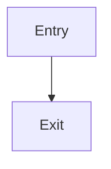
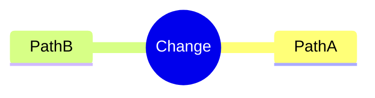
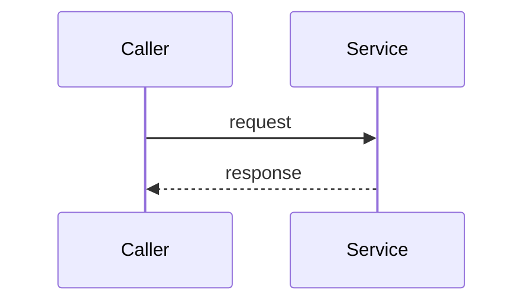
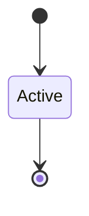
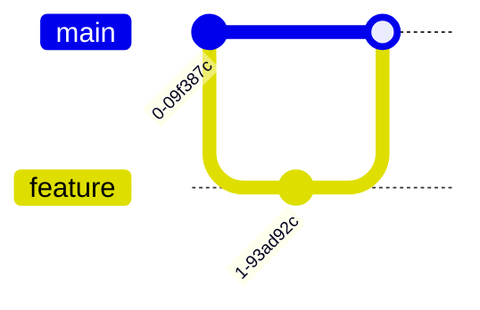
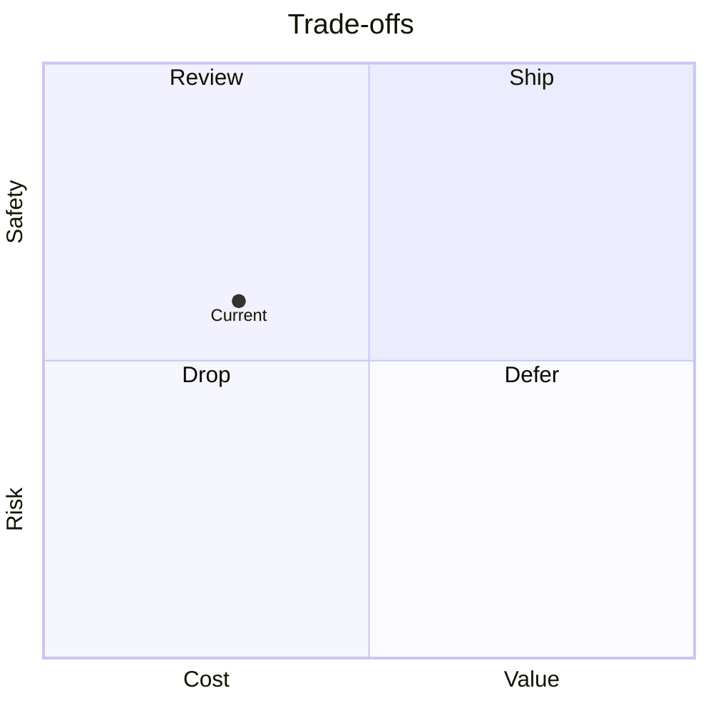
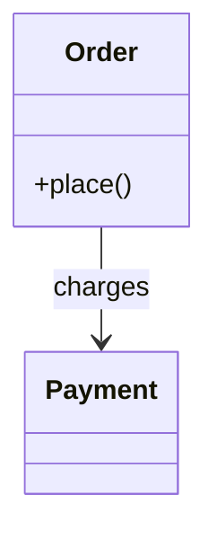
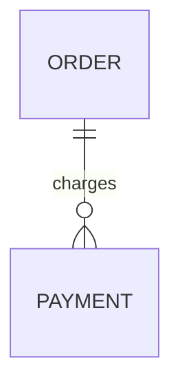
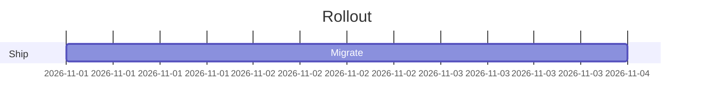

# Behavioral diagram contract (opt-in, agent-drawn)

Read this file before drawing a diagram. The diagram is optional: draw at
most one per review, and only when the change's flow needs a picture
(multi-step logic prose can't carry). The operator opts in via
`publish.diagrams.behavioral` — when off, the script strips every diagram
block silently. Never hand-draw the change-topology diagram (`report`
renders that from bundle data); never draw more than one block.

## Selection map (pick by change shape, never force a fit)

| Change shape              | Diagram type                 |
| ------------------------- | ---------------------------- |
| structure / call graph    | `flowchart` (or `mindmap`)   |
| call order over time      | `sequenceDiagram`            |
| lifecycles / states       | `stateDiagram`               |
| version chains / branches | `gitGraph`                   |
| option matrices           | `quadrantChart`              |
| data shapes / relations   | `classDiagram` / `erDiagram` |
| schedules / rollout order | `gantt`                      |

The script accepts exactly these keywords (plus `graph` as a `flowchart`
alias) — everything else, including beta-only types, is dropped with a note.

## Honesty rule (every node from the diff)

Every node, participant, state, branch, and edge must name code the diff
adds, modifies, or directly calls. Anything illustrative or assumed is
labeled `illustrative` in its own text (e.g. `Client (illustrative)`).
When in doubt, omit the node — an unverified diagram is worse than none.

## Skeletons (copy exact, then rename nodes to diff symbols)



















## Wrapper (copy exact, one block per review)

Place the block immediately after the metadata comment, before the first
finding. Keep the markers byte-exact — the script strips and replaces on
them, the way it does on the footer divider.

````html
<!-- verdict-diagram:start -->
<details>
  <summary>Behavior flow (generated — verify against the diff)</summary>

  ```mermaid sequenceDiagram participant C as Caller participant S as Service
  C->>S: request S-->>C: response ```
</details>
<!-- verdict-diagram:end -->
````

The `<summary>` line is the generated-content label — keep its wording.
Leave the block collapsed (`<details>`); the operator's
`publish.diagrams.expanded` knob renders it open when set.

## Caps

One diagram max — a second block is dropped with a note. Tabular
comparisons stay markdown tables — never convert a matrix to a diagram.

## Script behavior (so you know the consequences)

Grammar-level checks only: fenced block present, keyword in the allowlist
above, fences balanced, fence non-empty. Beta/unknown keywords, unbalanced
or empty fences, and cap extras are dropped with a one-line
`> Diagram omitted: …` note — the review never fails over a diagram.
